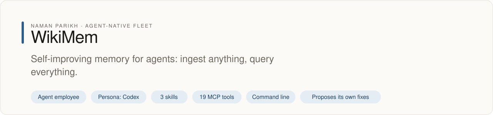
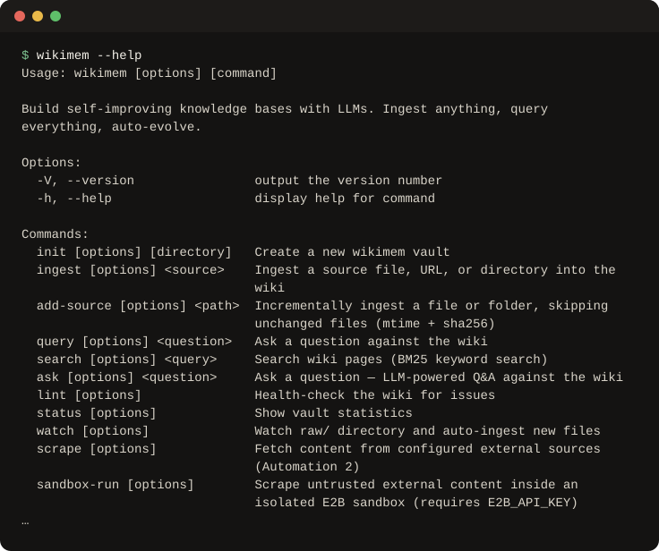

# WikiMem

<!-- fleet:header:start -->
<p align="center"><picture><source media="(prefers-color-scheme: dark)" srcset="assets/banner-dark.svg"></picture></p>

<p align="center">
<a href="https://github.com/naman10parikh/wikimem/actions"></a>
<a href="https://github.com/naman10parikh/wikimem/releases"></a>
<a href="LICENSE"></a>
<a href="AGENTS.md"></a>
<a href="#use-it-from-any-coding-agent"></a>
<a href="skills/"></a>
<a href="https://github.com/naman10parikh/wikimem/stargazers"></a>
<a href="https://x.com/naman10parikh"></a>
<a href="https://www.linkedin.com/in/naman-parikh1/"></a>
</p>

<p align="center"><a href="AGENTS.md">AGENTS.md</a> · <a href="llms.txt">llms.txt</a> · <a href="skills/">Skills</a> · <a href="docs/">Docs</a> · <a href="https://github.com/naman10parikh/wikimem/discussions">Discussions</a> · <a href="SECURITY.md">Security</a> · <a href="CONTRIBUTING.md">Contributing</a> · <a href="https://x.com/naman10parikh">X</a> · <a href="https://github.com/naman10parikh">All projects</a></p>

**Self-improving memory for agents: ingest anything, query everything.**

WikiMem is an agent employee, a packaged specialist agent with its own skills, memory and tests. It owns one job: memory. Its persona is Codex. Coding agents use it through its skills, its MCP server and its command line. A scheduled job runs its evals and proposes fixes. A person makes every change.

_WikiMem is part of an agent-native play for agent-native systems that can eventually be recursively self-improving and evolving, operated by agent employees._

<p align="center"></p>
<!-- fleet:header:end -->

WikiMem gives an agent a memory it can read, search and improve. Drop in files, links or a connected app, and it
compiles them into linked Markdown pages with citations, then answers questions from those pages. It is for anyone
who wants an agent, or a person, to build on what it learned last week instead of starting cold.

[](https://www.npmjs.com/package/wikimem) [](#13-formats-one-pipeline)

<!-- fleet:use:start -->
## Use it from any coding agent

**Claude Code**: the plugin brings the skills, sub-agents, hooks and MCP server.

```
/plugin marketplace add naman10parikh/wikimem
/plugin install wikimem@wikimem
```

<details><summary>Its MCP server, Codex, Cursor, Gemini CLI, one skill and the command line</summary>

**Its MCP server**, in any MCP client:

```bash
claude mcp add --transport stdio wikimem -- npx -y -p github:naman10parikh/wikimem wikimem-mcp
codex mcp add wikimem -- npx -y -p github:naman10parikh/wikimem wikimem-mcp
```

Cursor (`.cursor/mcp.json`), Gemini CLI (`.gemini/settings.json`) and most other clients take the same command as JSON:

```json
{
  "mcpServers": {
    "wikimem": {
      "command": "npx",
      "args": [
        "-y",
        "-p",
        "github:naman10parikh/wikimem",
        "wikimem-mcp"
      ]
    }
  }
}
```

**Gemini CLI**: the extension brings the context and the MCP server.

```bash
gemini extensions install https://github.com/naman10parikh/wikimem
```

**One skill** (3 in all, in [skills/](skills/)), in any agent that reads Agent Skills:

```bash
gemini skills install https://github.com/naman10parikh/wikimem --path skills/wikimem
git clone --depth 1 https://github.com/naman10parikh/wikimem /tmp/wikimem && cp -r /tmp/wikimem/skills/wikimem ~/.claude/skills/
```

**The command line:**

```bash
npx -y -p github:naman10parikh/wikimem wikimem --help
```

</details>

Codex, Cursor, OpenCode, GitHub Copilot and other agents read [AGENTS.md](AGENTS.md); Claude Code reads [CLAUDE.md](CLAUDE.md) and Gemini CLI reads [GEMINI.md](GEMINI.md), which import it. [llms.txt](llms.txt) maps every surface for agents that read first.
<!-- fleet:use:end -->

## Quick start

These commands were run for this README. They need Node.js 18 or later and no API key.

```bash
alias wikimem='npx -y -p github:naman10parikh/wikimem wikimem'
wikimem init my-wiki      # create a vault: wiki/, raw/, AGENTS.md, config.yaml
cd my-wiki
wikimem status            # pages, words, sources, links, orphans
wikimem lint              # orphan pages, broken wikilinks, missing summaries
wikimem observe           # score every page and list what to improve (free without --improve)
wikimem serve             # the web app at http://localhost:3141, and the MCP endpoint /mcp
```

The first `npx` run downloads and builds WikiMem, which takes a minute; later runs start at once. `npx wikimem@latest`
installs the last npm release (0.8.6); the GitHub form above runs this repository's code (0.10.0).

To turn sources into pages and ask questions, give WikiMem an LLM: set `ANTHROPIC_API_KEY` or `OPENAI_API_KEY`, or run
[Ollama](https://ollama.com/) locally. Then:

```bash
wikimem ingest paper.pdf
wikimem ingest https://en.wikipedia.org/wiki/Large_language_model
wikimem ask "What are the key themes across my sources?"
```

## How it works

WikiMem takes [Karpathy's LLM wiki idea](https://x.com/karpathy/status/1908625766490001799) and turns it into a full
tool. A vault has two layers. `raw/` holds your original sources and is never edited. `wiki/` holds the pages an LLM
writes from them, with cross-references and citations. Every change is a git commit, so you can browse history and
restore any snapshot.

```
raw/                        wiki/
  paper.pdf                   index.md ........... content catalog
  podcast.mp3    ──LLM──>    sources/paper.md ... summary + citations
  screenshot.png              entities/openai.md . people, orgs, tools
  meeting.docx                concepts/rag.md .... ideas + frameworks
  blog-url                    syntheses/ ......... cross-cutting analysis
```

The vault's own `AGENTS.md` is the schema that tells the LLM how to structure pages, and it changes as the wiki grows.
Three automations keep the wiki growing and improving while you sleep:

| Automation | Trigger | What it does |
| --- | --- | --- |
| **Ingest** | File watcher on `raw/` | New file detected, processed, turned into wiki pages, committed to git |
| **Scrape** | Cron schedule or manual | RSS feeds, GitHub trending and URLs are fetched into `raw/`, which triggers Ingest |
| **Observe** | Nightly or manual | Scores every page (coverage, consistency, cross-linking, freshness, organization), proposes improvements and applies them within a budget |

### 13 formats, one pipeline

WikiMem detects the file type, runs the right processor, and writes pages with cross-references and citations. The
web app shows each step: file detection, text extraction, LLM processing, page generation, cross-linking, indexing.

| Format | Extensions | Processor |
| --- | --- | --- |
| Text | `.md`, `.txt` | Direct read |
| Structured | `.json`, `.csv`, `.yaml` | Schema-aware extraction |
| PDF | `.pdf` | Built-in text extraction |
| Office | `.docx`, `.pptx`, `.xlsx` | Document parsing |
| HTML | `.html`, `.htm` | Tag stripping and content extraction |
| Image | `.png`, `.jpg`, `.gif`, `.webp` | Claude Vision description |
| Audio | `.mp3`, `.wav`, `.m4a`, `.ogg`, `.flac` | Whisper or Deepgram transcription |
| Video | `.mp4`, `.mov`, `.avi`, `.mkv`, `.webm` | ffmpeg, then Whisper transcription |
| URL | `https://...` | Firecrawl or fetch, then Markdown |

`wikimem add-source <path>` ingests only new or changed files (by modification time and SHA-256), so a folder that
changes daily stays in sync cheaply. `wikimem sandbox-run` fetches untrusted pages inside an isolated E2B sandbox
and keeps only the cleaned Markdown.

### Search, ask and see the graph

- **Search:** `wikimem search` is BM25 keyword search across every page; embeddings can add semantic search.
- **Ask:** `wikimem ask` answers from your pages and cites them; `wikimem query --file` saves the answer as a
  synthesis page.
- **Knowledge graph:** an interactive D3 force-directed graph. Click a node to highlight its neighbours,
  double-click to open it. Community detection clusters related pages; hub nodes are sized by their links.
- **Time-lapse:** watch the wiki grow commit by commit, as pages appear and links form.

### The web app

`wikimem serve` opens a full editor at [localhost:3141](http://localhost:3141):

- **File tree** with collapsible folders, and a **tabbed editor** with WYSIWYG Markdown (`Cmd+S` saves and commits)
- **Knowledge graph**, **pipeline view** (drag and drop a file, watch each step) and **time-lapse**
- **Search** (`Cmd+K`) and a **command palette** (`Cmd+P`)
- **Settings** for API keys, models and automations, and **Ask your knowledge** from the browser

### Connectors

Sync outside sources into the vault on a schedule.

| Connector | Status |
| --- | --- |
| Local folders, Git repos, GitHub, webhooks | ✅ Shipped |
| Slack, Gmail and Google Drive, Discord | ✅ Shipped |
| RSS feeds | ✅ Shipped |
| Notion, Linear, Jira | ✅ Shipped |
| Microsoft 365, LinkedIn | 🔜 Coming soon |

### MCP server and Claude custom connector

Over stdio, `wikimem-mcp --vault <path>` (or `wikimem mcp --vault <path>`) serves a vault's 19 tools to Claude Code,
Cursor or any MCP client; with no `--vault` it serves the current folder. The tools are listed in
[AGENTS.md](AGENTS.md#mcp-server-wikimem-mcp).

Over HTTP, `wikimem serve` exposes the same tools at `/mcp` behind OAuth 2.1, in the dialect Claude's custom
connectors speak:

1. **Start WikiMem:** `wikimem serve` (default `http://localhost:3141`).
2. **Expose it with HTTPS.** Claude requires HTTPS except for `localhost`. For example, run `ngrok http 3141`, then
   `export WIKIMEM_PUBLIC_URL=https://abc.ngrok.app` and restart `wikimem serve` so the metadata advertises it.
3. **Add it in Claude:** [Settings, then Connectors](https://claude.ai/settings/connectors), then **Add Custom
   Connector**, and paste `https://abc.ngrok.app/mcp` (or `http://localhost:3141/mcp` on the same machine). Claude
   fetches `/.well-known/oauth-protected-resource` and `/.well-known/oauth-authorization-server`, registers a client
   at `/oauth/register`, opens `/oauth/authorize` (click **Allow** once), exchanges the code at `/oauth/token`, and
   calls `/mcp` with the token. All 19 tools appear, and Claude cites pages from your vault.

| Variable | Purpose |
| --- | --- |
| `WIKIMEM_PUBLIC_URL` | The public issuer and resource URL advertised in the metadata |
| `WIKIMEM_OAUTH_SECRET` | The HS256 signing key for access tokens. Created and saved to `.wikimem/oauth-secret` (mode `0600`) if unset |
| `WIKIMEM_OAUTH_AUTO_APPROVE` | Set to `1` to skip the consent screen (tests and CI only) |

Tokens never leave your machine, and the signing secret stays inside your vault folder.

### Commands

| Command | Description |
| --- | --- |
| `wikimem init [dir]` | Create a vault (`--template personal\|research\|business\|codebase`, `--from-folder`, `--from-repo`) |
| `wikimem serve` | Start the web app on port 3141 |
| `wikimem ingest <source>` | Turn a file or URL into wiki pages |
| `wikimem add-source <path>` | Ingest only new or changed files |
| `wikimem search <term>` | BM25 full-text search across wiki pages |
| `wikimem ask <question>` | Ask a question, get an answer from your wiki |
| `wikimem query <question>` | Ask, and optionally save the answer as a synthesis page (`--file`) |
| `wikimem lint` | Health check: orphan pages, broken links, missing summaries (`--fix`) |
| `wikimem status` | Vault statistics: pages, words, sources, links, orphans (`--json`) |
| `wikimem watch` | Auto-ingest files dropped into `raw/` |
| `wikimem scrape` | Fetch from configured RSS, GitHub and URL sources |
| `wikimem sandbox-run` | Fetch untrusted content inside an E2B sandbox (needs `E2B_API_KEY`) |
| `wikimem observe` | Score pages, find orphans and gaps (`--improve`, `--budget 2.0`, `--json`) |
| `wikimem improve` | Run a self-improvement cycle (`--dry-run`, `--threshold 90`) |
| `wikimem export` | Export the wiki as graph data (JSON, CSV or GraphML) |
| `wikimem publish` | Publish the wiki as a static site, RSS, JSON feed or digest (`--format html,rss,json-feed,digest`) |
| `wikimem open` | Open a page in the browser |
| `wikimem history` | Browse the change history and restore snapshots |
| `wikimem duplicates` | List sources rejected as near-duplicates |
| `wikimem mcp` | Start the MCP server over stdio |

### Configuration

After `wikimem init`, the vault holds `config.yaml`:

```yaml
provider: claude                    # claude | openai | ollama
model: claude-sonnet-4-20250514

sources:
  - name: "HN Front Page"
    type: rss
    url: "https://hnrss.org/frontpage"

  - name: "GitHub Trending TS"
    type: github
    query: "stars:>100 created:>7d language:typescript"

improvement:
  threshold: 80
  schedule: "0 3 * * *"            # 3am nightly
```

| Variable | Purpose |
| --- | --- |
| `ANTHROPIC_API_KEY` | Claude API access (the default provider) |
| `OPENAI_API_KEY` | OpenAI API access |
| `OLLAMA_BASE_URL` | Ollama server URL (default `http://localhost:11434`) |
| `FIRECRAWL_API_KEY` | Better URL-to-Markdown (optional) |
| `DEEPGRAM_API_KEY` | Audio transcription (optional; falls back to Whisper) |
| `E2B_API_KEY` | The sandbox for `wikimem sandbox-run` (optional) |

| Provider | Flag | Default model |
| --- | --- | --- |
| Claude | `-p claude` | `claude-sonnet-4-20250514` |
| OpenAI | `-p openai` | `gpt-4o` |
| Ollama | `-p ollama` | `llama3.2` |

Ollama runs fully local: no API keys, no network, no data leaves your machine.

### Obsidian and privacy

Every vault is an Obsidian vault. Open the folder in Obsidian with no plugins: `[[wikilinks]]` become backlinks,
YAML frontmatter becomes page metadata, and the graph and tag views work.

Everything runs locally; the wiki is a folder of Markdown files. Nothing leaves your machine except LLM calls, and
those are optional with Ollama. `raw/` and `config.yaml` are excluded from git by default.

| Path | Safe to commit? | Why |
| --- | :-: | --- |
| `wiki/` | ✅ | LLM-written summaries, no raw personal data |
| `AGENTS.md` | ✅ | The schema file, no personal data |
| `raw/` | ❌ | Your original source files |
| `config.yaml` | ❌ | May contain API keys |

### Credits

Inspired by [Andrej Karpathy's LLM wiki pattern](https://x.com/karpathy/status/1908625766490001799): LLMs should
compile knowledge into structured, linked wikis rather than only answer from raw chunks. Built with
[Express](https://expressjs.com/), [D3](https://d3js.org/), [simple-git](https://github.com/steveukx/git-js), and the
[Claude](https://docs.anthropic.com/), [OpenAI](https://platform.openai.com/) and [Ollama](https://ollama.com/) APIs.

<!-- fleet:anatomy:start -->
## What it is made of

Every project in this fleet is graded on the same 11 harness components and on self-improvement. Each mark is backed by a file you can open.

| Component | Grade | Where |
| --- | --- | --- |
| Identity | ✅ | identity/SOUL.md:1 |
| Memory | ✅ | src/search/bm25.ts:21 |
| Skills | ✅ | skills/wikimem/SKILL.md:1 |
| Tools/CLIs | ✅ | package.json:6 |
| Hooks | ✅ | .claude/settings.json:4 |
| Sub-agents | ✅ | .claude/agents/vault-curator.md:1 |
| MCPs | ✅ | src/mcp-server.ts:65 |
| Dispatch | ✅ | src/core/scheduler.ts:81 |
| Evals | ✅ | eval/run.mjs:1 |
| Observability | ✅ | src/core/audit-trail.ts:32 |
| Sandbox/Infra | ✅ | src/core/sandbox-scrape.ts:105 |
| Self-improvement | ✅ | dsip.json:1 |

✅ real and tested · 🟡 partial, with the reason in the row · ❌ absent
<!-- fleet:anatomy:end -->

<!-- fleet:footer:start -->
## How it improves itself

It carries its own evals and a self-improvement contract, [`dsip.json`](dsip.json), which says what it may change and how a change is judged. A scheduled job runs its evals and proposes fixes. A person makes every change. Lessons it learns are kept as rules in its memory files.

## Part of a fleet

One of the projects by [Naman Parikh](https://github.com/naman10parikh). Each owns one part of an agent's harness, or of the product around an agent, and all of them follow one standard.

Siblings: [agentdial](https://github.com/naman10parikh/agentdial) (identity) · [skillsmith](https://github.com/naman10parikh/skillsmith) (skills) · [agent-booster](https://github.com/naman10parikh/agent-booster) (tools / CLIs) · [armory](https://github.com/naman10parikh/armory) (MCPs and the component registry) · [agentgrid](https://github.com/naman10parikh/agentgrid) (dispatch) · [agentswarm](https://github.com/naman10parikh/agentswarm) (dispatch) · [agentbench](https://github.com/naman10parikh/agentbench) (evals) · [agentmoney](https://github.com/naman10parikh/agentmoney) (observability) · [claude-harness](https://github.com/naman10parikh/claude-harness) (the whole harness, as a template).

## Community

Questions and ideas go to [Discussions](https://github.com/naman10parikh/wikimem/discussions); bugs go to [issues](https://github.com/naman10parikh/wikimem/issues/new/choose). Follow the work on [X](https://x.com/naman10parikh) and [LinkedIn](https://www.linkedin.com/in/naman-parikh1/).

## Contributing and security

Read [CONTRIBUTING.md](CONTRIBUTING.md). AI-assisted pull requests are welcome. Report a vulnerability privately, as [SECURITY.md](SECURITY.md) explains.

## License

MIT, © 2026 Naman Parikh. See [LICENSE](LICENSE) and [NOTICE](NOTICE).

## Star history

If it is useful to you, a star helps other people find it.

<a href="https://star-history.com/#naman10parikh/wikimem&Date"><picture><source media="(prefers-color-scheme: dark)" srcset="https://api.star-history.com/svg?repos=naman10parikh/wikimem&type=Date&theme=dark"></picture></a>

## Contributors

<a href="https://github.com/naman10parikh/wikimem/graphs/contributors"></a>
<!-- fleet:footer:end -->
