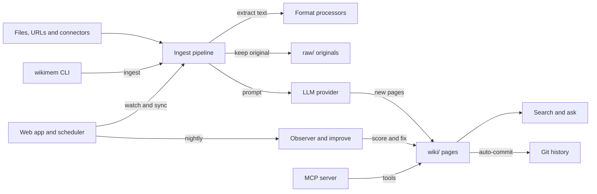

# How WikiMem works

WikiMem turns files, web pages and connected apps into a wiki of linked Markdown pages that a language model writes.
Each wiki lives in a vault, a plain folder that Obsidian can also open.
WikiMem runs on your machine as a command-line tool, a local web app and an MCP server.
It is for people and coding agents who want a knowledge base that grows with every source.
It also scores its own pages and repairs the weak ones.

## The parts

A vault has three parts.
`raw/` keeps every original source unchanged.
`wiki/` holds the pages the model writes, linked to each other with `[[wikilinks]]`.
`AGENTS.md` is the schema the model reads before it writes anything.
[src/core/vault.ts](../src/core/vault.ts) defines this layout and reads and writes pages.
[src/cli/index.ts](../src/cli/index.ts) registers the commands, one file each in [src/cli/commands/](../src/cli/commands/).

[src/core/ingest.ts](../src/core/ingest.ts) runs the pipeline.
It hands each file type to a processor in [src/processors/](../src/processors/).
It asks a model, chosen in [src/providers/index.ts](../src/providers/index.ts), to turn the text into pages.
[src/search/index.ts](../src/search/index.ts) ranks pages with BM25, a keyword scoring method, and can add embedding search.
[src/core/query.ts](../src/core/query.ts) answers questions from the best matching pages.
[src/core/observer.ts](../src/core/observer.ts) scores every page, and [src/core/improve.ts](../src/core/improve.ts) fixes weak ones.
[src/web/server.ts](../src/web/server.ts) serves the web app and starts the jobs in [src/core/scheduler.ts](../src/core/scheduler.ts).
[src/mcp-server.ts](../src/mcp-server.ts) offers 19 tools to coding agents over MCP, the Model Context Protocol.
[src/core/mcp-client/](../src/core/mcp-client/) lets WikiMem connect to other MCP servers as a client.

## What happens when you run it

The main flow is `wikimem ingest <file or URL>` inside a vault made by `wikimem init`.

1. [src/cli/commands/ingest.ts](../src/cli/commands/ingest.ts) finds the vault and reads `config.yaml`. [src/providers/index.ts](../src/providers/index.ts) builds the model provider. With a provider chain set, it tries each provider in turn until one answers.
2. [src/core/ingest.ts](../src/core/ingest.ts) detects the source type. PDFs, Office files, CSV, images, audio and video go to the matching file in [src/processors/](../src/processors/). Web pages go to [src/processors/url.ts](../src/processors/url.ts).
3. It checks for duplicates. First it looks for an exact hash match in `raw/`. Then it compares word overlap with existing pages and rejects anything above 70 percent. A rejected source gets a `.meta.json` note beside it. The `--force` flag skips this check.
4. It copies the original into `raw/<date>/`.
5. It builds a prompt from `AGENTS.md`, the current `wiki/index.md` and the first 12,000 characters of the source. [src/core/pipeline-prompts.ts](../src/core/pipeline-prompts.ts) holds the default prompts, and `config.yaml` can override them.
6. It splits the model's reply into pages and writes each one under `wiki/<category>/`. The front matter records the title, tags, source, summary, a confidence score and an unreviewed status. If a page already exists, its old version is kept in `.wikimem/versions/`.
7. If an embedding provider is set, it stores an embedding for each new page.
8. [src/core/index-manager.ts](../src/core/index-manager.ts) updates `wiki/index.md`, and [src/core/log-manager.ts](../src/core/log-manager.ts) appends to `wiki/log.md`.
9. If the vault is a git repository, [src/core/git.ts](../src/core/git.ts) commits the change. [src/core/history.ts](../src/core/history.ts) also records a snapshot.

## Extending it

- **A new file type.** Add a processor to [src/processors/](../src/processors/) that returns Markdown and a title. Then add a branch for it in [src/core/ingest.ts](../src/core/ingest.ts) and a test in [tests/](../tests/).
- **A new model provider.** Implement the `LLMProvider` interface from [src/providers/types.ts](../src/providers/types.ts). Then add a case for it in `createProvider` in [src/providers/index.ts](../src/providers/index.ts).
- **A new connector.** Prefer a remote MCP server. Add it to the catalog in [src/core/mcp-client/known-servers.json](../src/core/mcp-client/known-servers.json), and the MCP client handles sign-in. The older per-platform syncs live in [src/core/sync/](../src/core/sync/) and are registered in [src/core/sync/index.ts](../src/core/sync/index.ts).
- **A new MCP tool.** Add its definition to the `TOOLS` list and a case to `handleToolCall` in [src/mcp-server.ts](../src/mcp-server.ts). Larger handlers live in [src/mcp-tools-extended.ts](../src/mcp-tools-extended.ts).
- **A new command.** Write a `register` function in [src/cli/commands/](../src/cli/commands/) and call it from [src/cli/index.ts](../src/cli/index.ts).
- **A new quality check.** The optional observer passes live in [src/core/observer-patterns/](../src/core/observer-patterns/) and are called from [src/core/observer.ts](../src/core/observer.ts).
- **A new golden eval.** Add a task with an id, a description and a pass test to the `TASKS` list in [eval/run.mjs](../eval/run.mjs).
- **A new skill.** Add `skills/<name>/SKILL.md` beside the three in [skills/](../skills/).

Then run `pnpm build`, `pnpm test` and `pnpm eval`.

## Questions

**Does it need an API key or cost money?**
WikiMem is free and MIT licensed.
Search, lint, status and the observer's scores work without a key.
Writing pages needs a model.
Claude and OpenAI need an API key, and that provider bills you.
Ollama runs models on your own machine for free.
The `claude-code` mode uses your Claude Code subscription through `claude -p`.
Image descriptions need an Anthropic key.
Audio needs an OpenAI or Deepgram key, or the local Whisper tool.

**Does any data leave the machine?**
The vault itself stays in a local folder.
Source text goes to the model provider you choose, unless that provider is Ollama.
Images go to the Anthropic API, and audio goes to OpenAI or Deepgram when those keys are set.
Connectors fetch from the platforms you sign in to.
When the web app starts, [src/core/privacy.ts](../src/core/privacy.ts) writes a `.gitignore` that keeps `raw/`, `config.yaml` and token files out of git.
Once a day the CLI asks the npm registry whether a newer version exists.

**How does it improve itself?**
There are two loops.
Inside a vault, the web app's scheduler runs the observer every night at 3 AM.
The observer scores every page out of 24.
It lists orphan pages, links to missing pages and possible contradictions.
In that nightly run it also asks the model to improve up to three of the weakest pages.
`wikimem improve` scores five quality dimensions and fixes pages when the total falls below 80, the default threshold.
For this repository, [.github/workflows/improve.yml](../.github/workflows/improve.yml) runs every Monday.
It builds, runs the tests and the golden evals, then runs [eval/propose.mjs](../eval/propose.mjs).
That script points WikiMem at the repository's own notes in [brain/](../brain/) and writes proposals, and a person merges any change.
The workflow then opens one issue labelled `proposal`, or updates the one already open, so a person can review them.
[dsip.json](../dsip.json) names no level. It lists the steps observe, score, propose, validate and ship.

**How do I run its tests or evals?**
Run `pnpm install` and `pnpm build`.
`pnpm test` runs the Vitest suites in [tests/](../tests/).
`pnpm eval` runs the seven golden tasks in [eval/run.mjs](../eval/run.mjs), three times each, with every model key removed.
[eval/README.md](../eval/README.md) explains each layer, including the browser audit in [scripts/vibe-audit.mjs](../scripts/vibe-audit.mjs).

**What does it not do?**
It is not a hosted service, so there is no account and no server beyond the one you start.
It is not a vector database. Search is BM25 by default, and embeddings are optional.
During ingest the model sees only the first 12,000 characters of each source.
Tokens for MCP servers are stored on disk in plain text, readable only by you.
It never merges its own proposals into this repository.

## More

- [architecture.md](architecture.md): the three layers and three automations in more depth.
- [configuration.md](configuration.md): every field in `config.yaml`.
- [OAUTH-APP-REGISTRATION.md](OAUTH-APP-REGISTRATION.md): registering OAuth apps for the built-in connectors.
- [connector-architecture-reference.md](connector-architecture-reference.md): how Claude connectors and MCP sign-in work.
- [agentdial-integration.md](agentdial-integration.md): reaching a wiki by email, Slack or SMS through AgentDial.
- [value-prop-claude-code.md](value-prop-claude-code.md): why to use WikiMem beside Claude Code and Obsidian.
- [competitive-landscape.md](competitive-landscape.md): similar projects and how they compare.
- [planning/](planning/): working plans, design audits and the task list from earlier releases.
